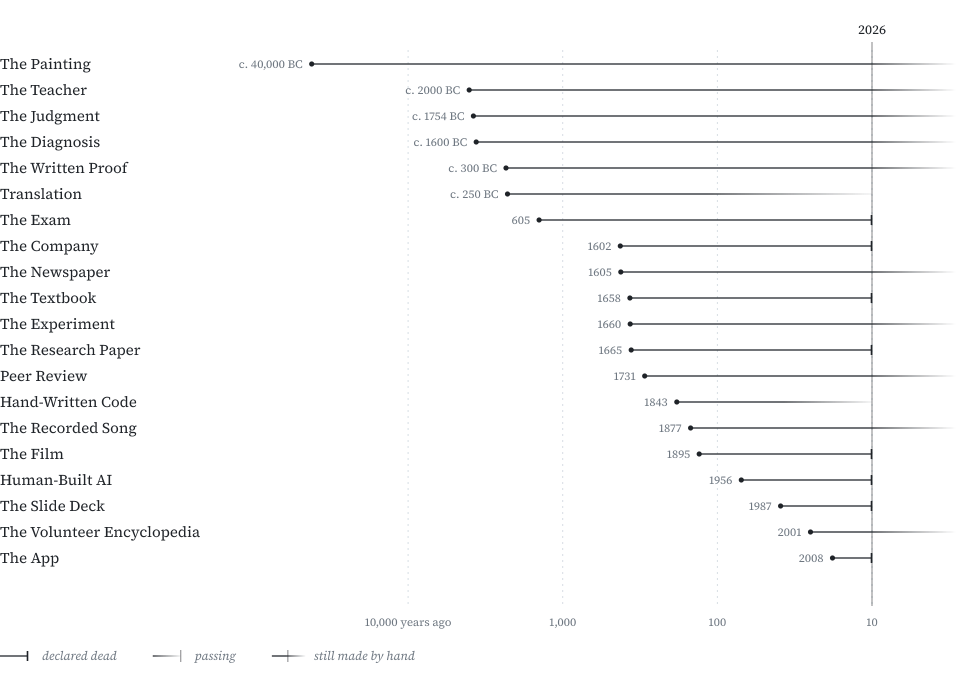

<div align="center">

<br>

<picture>
  <source media="(prefers-color-scheme: dark)" srcset="docs/assets/mark-dark.svg">
  
</picture>

# Awesome Last Human-Made

*A graveyard of things humans used to make.*

<sub>**English** · [简体中文](README.zh-CN.md)</sub>

</div>

<br>

Behind every paper, every proof, every song, every verdict, there used to be a pair of hands: someone who stayed up too late, crossed things out, and at last signed their name.

Now the works arrive with their epitaphs already carved — *The Last Human-Written Paper*, *The Last Math Competition*, *The Last AI Built by Humans* — and the machines, quietly, go on finishing what we began.

This is where we write it down: when each thing was born, how long our hands held it, and who said it was over. Most of them, so far, are still breathing.

<br>

<picture>
  <source media="(prefers-color-scheme: dark)" srcset="docs/assets/timeline-dark.svg">
  
</picture>

<p align="center"><sub><i>Each line runs from the year a form of work began to the present. Twenty of them, some forty thousand years long, meet in the same year.</i></sub></p>

<br>

| Form | Life | Now
| :-- | :-- | :-- |
| [The Research Paper](#paper) | 1665 – 2026? | <sub><i>declared dead</i></sub> |
| [Peer Review](#peer-review) | 1731 – | <sub><i>still made by hand</i></sub> |
| [The Written Proof](#proof) | c. 300 BC – | <sub><i>still made by hand</i></sub> |
| [The Exam](#exam) | 605 – 2026? | <sub><i>declared dead</i></sub> |
| [The Textbook](#textbook) | 1658 – 2026? | <sub><i>declared dead</i></sub> |
| [The Volunteer Encyclopedia](#encyclopedia) | 2001 – | <sub><i>still made by hand</i></sub> |
| [Hand-Written Code](#code) | 1843 – 2026 | <sub><i>passing</i></sub> |
| [Human-Built AI](#ai) | 1956 – 2026? | <sub><i>declared dead</i></sub> |
| [The Company](#company) | 1602 – 2026? | <sub><i>declared dead</i></sub> |
| [The App](#app) | 2008 – 2026? | <sub><i>declared dead</i></sub> |
| [The Slide Deck](#slides) | 1987 – 2026? | <sub><i>declared dead</i></sub> |
| [The Film](#film) | 1895 – 2026? | <sub><i>declared dead</i></sub> |
| [The Recorded Song](#song) | 1877 – | <sub><i>still made by hand</i></sub> |
| [The Newspaper](#newspaper) | 1605 – | <sub><i>still made by hand</i></sub> |
| [Translation](#translation) | c. 250 BC – 2026 | <sub><i>passing</i></sub> |
| [The Painting](#art) | c. 40,000 BC – | <sub><i>still made by hand</i></sub> |
| [The Teacher](#teacher) | c. 2000 BC – | <sub><i>still made by hand</i></sub> |
| [The Diagnosis](#diagnosis) | c. 1600 BC – | <sub><i>still made by hand</i></sub> |
| [The Experiment](#experiment) | 1660 – | <sub><i>still made by hand</i></sub> |
| [The Judgment](#judgment) | c. 1754 BC – | <sub><i>still made by hand</i></sub> |

<br>

<br>

<a id="plot-knowledge"></a>

<picture>
  <source media="(prefers-color-scheme: dark)" srcset="docs/assets/chapters/knowledge-dark.svg">
  
</picture>

<br>

<a id="paper"></a>

### The Research Paper

**1665 – 2026?**

Born with the first issue of *Philosophical Transactions*. Made by hand for 361 years. Declared dead by The Last Human-Written Paper; to be succeeded by agent-native research artifacts.

> *It held three centuries of science in eight pages, and left out every failed experiment.*

- **[The Last Human-Written Paper: Agent-Native Research Artifacts](https://arxiv.org/abs/2604.24658)**<br>
  Replaces the narrative PDF with an executable research package that keeps dead ends, design decisions and full implementation detail.<br>
  <sub>manifesto, protocol · Apr 2026</sub><br>
  <a href="https://arxiv.org/abs/2604.24658"><picture><source media="(prefers-color-scheme: dark)" srcset="docs/assets/buttons/paper-arxiv-dark.svg"></picture></a> <a href="https://github.com/ARA-Labs/Agent-Native-Research-Artifact"><picture><source media="(prefers-color-scheme: dark)" srcset="docs/assets/buttons/code-code-dark.svg"></picture></a> <a href="https://github.com/Orchestra-Research/Agent-Native-Research-Artifact-template"><picture><source media="(prefers-color-scheme: dark)" srcset="docs/assets/buttons/code-template-dark.svg"></picture></a> <a href="https://github.com/ARA-Labs/ARA-Demo"><picture><source media="(prefers-color-scheme: dark)" srcset="docs/assets/buttons/code-demo-dark.svg"></picture></a>
- **[The AI Scientist-v2](https://www.nature.com/articles/s41586-026-10265-5)**<br>
  Its fully AI-generated paper passed peer review at an ICLR 2025 workshop; the system itself was published in Nature.<br>
  <sub>demo · 2026</sub><br>
  <a href="https://www.nature.com/articles/s41586-026-10265-5"><picture><source media="(prefers-color-scheme: dark)" srcset="docs/assets/buttons/paper-nature-dark.svg"></picture></a> <a href="https://x.com/SakanaAILabs/status/2036840833690071450"><picture><source media="(prefers-color-scheme: dark)" srcset="docs/assets/buttons/post-u9b7e3270-dark.svg"></picture></a>
- **[Agents4Science 2025](https://agents4science.stanford.edu)**<br>
  The first conference where AI systems are both the primary authors and the reviewers.<br>
  <sub>demo · Oct 2025</sub><br>
  <a href="https://agents4science.stanford.edu"><picture><source media="(prefers-color-scheme: dark)" srcset="docs/assets/buttons/site-website-dark.svg"></picture></a> <a href="https://arxiv.org/abs/2511.15534"><picture><source media="(prefers-color-scheme: dark)" srcset="docs/assets/buttons/paper-report-dark.svg"></picture></a> <a href="https://x.com/james_y_zou/status/2001331557643276613"><picture><source media="(prefers-color-scheme: dark)" srcset="docs/assets/buttons/post-ued395fe4-dark.svg"></picture></a>
- **[paper.json](https://arxiv.org/abs/2605.16194)**<br>
  A companion file that travels with the PDF, giving every claim a stable ID and an explicit “does-not-claim” list for agent readers.<br>
  <sub>protocol · May 2026</sub><br>
  <a href="https://arxiv.org/abs/2605.16194"><picture><source media="(prefers-color-scheme: dark)" srcset="docs/assets/buttons/paper-arxiv-dark.svg"></picture></a> <a href="https://github.com/arquicanedo/paper-json"><picture><source media="(prefers-color-scheme: dark)" srcset="docs/assets/buttons/code-code-dark.svg"></picture></a>
- **[Agentic Publication Protocol (APP)](https://arxiv.org/abs/2606.27386)**<br>
  Ships a paper as a repository release, with code, data, environment and an agent-facing instruction file.<br>
  <sub>protocol · Jun 2026</sub><br>
  <a href="https://arxiv.org/abs/2606.27386"><picture><source media="(prefers-color-scheme: dark)" srcset="docs/assets/buttons/paper-arxiv-dark.svg"></picture></a>
- **[Traxia: Verifiable, Agent-Native Scientific Publishing](https://arxiv.org/abs/2606.08256)**<br>
  <sub>protocol · Jun 2026</sub><br>
  <a href="https://arxiv.org/abs/2606.08256"><picture><source media="(prefers-color-scheme: dark)" srcset="docs/assets/buttons/paper-arxiv-dark.svg"></picture></a>
- **[Knows: Agent-Native Structured Research Representations](https://arxiv.org/abs/2604.17309)**<br>
  <sub>protocol · Apr 2026</sub><br>
  <a href="https://arxiv.org/abs/2604.17309"><picture><source media="(prefers-color-scheme: dark)" srcset="docs/assets/buttons/paper-arxiv-dark.svg"></picture></a>
- **[Rethinking Publication: A Certification Framework for AI-Enabled Research](https://arxiv.org/abs/2604.22026)**<br>
  Separates judging the knowledge from grading the human contribution, so pipeline-generated work can be published consistently.<br>
  <sub>protocol · Apr 2026</sub><br>
  <a href="https://arxiv.org/abs/2604.22026"><picture><source media="(prefers-color-scheme: dark)" srcset="docs/assets/buttons/paper-arxiv-dark.svg"></picture></a>
- **[The Scientific Paper as a Human Artifact](https://www.preprints.org/manuscript/202609.2371)**<br>
  The paper is not obsolete, but its monopoly is ending; its human-facing functions must be kept on purpose.<br>
  <sub>critique · Sep 2026</sub><br>
  <a href="https://www.preprints.org/manuscript/202609.2371"><picture><source media="(prefers-color-scheme: dark)" srcset="docs/assets/buttons/paper-preprints-dark.svg"></picture></a>
- **[Should Researchers Write Papers for AI Instead of People?](https://spectrum.ieee.org/ai-scientist-research-paper-format)**<br>
  <sub>commentary · 2026</sub><br>
  <a href="https://spectrum.ieee.org/ai-scientist-research-paper-format"><picture><source media="(prefers-color-scheme: dark)" srcset="docs/assets/buttons/article-ieee-spectrum-dark.svg"></picture></a>
- **[Again, the research paper format will be dying out](https://marginalrevolution.com/marginalrevolution/2026/06/again-the-paper-format-will-be-dying-out.html)**<br>
  <sub>commentary · Jun 2026</sub><br>
  <a href="https://marginalrevolution.com/marginalrevolution/2026/06/again-the-paper-format-will-be-dying-out.html"><picture><source media="(prefers-color-scheme: dark)" srcset="docs/assets/buttons/article-marginal-revolution-dark.svg"></picture></a>
- **[The Last Human-Written Paper](https://pub.towardsai.net/the-last-human-written-paper-a14d29470ff7)**<br>
  Calls the title an overclaim; the approach mainly fits code-based research.<br>
  <sub>critique · 2026</sub><br>
  <a href="https://pub.towardsai.net/the-last-human-written-paper-a14d29470ff7"><picture><source media="(prefers-color-scheme: dark)" srcset="docs/assets/buttons/article-towards-ai-dark.svg"></picture></a>
<br>

<p align="center"><picture><source media="(prefers-color-scheme: dark)" srcset="docs/assets/mark-dark.svg"></picture></p>

<br>

<a id="peer-review"></a>

### Peer Review

**1731 –**

Born with the refereed *Medical Essays* of the Royal Society of Edinburgh. Made by hand for 295 years, and still is. Challenged by AI review at conference scale.

> *Still reading the paper. Still asking for one more ablation.*

- **[AAAI-26 AI Review Pilot](https://arxiv.org/abs/2604.13940)**<br>
  AI-written reviews for every submission at under $1 per paper; respondents preferred them on technical accuracy.<br>
  <sub>demo · Apr 2026</sub><br>
  <a href="https://arxiv.org/abs/2604.13940"><picture><source media="(prefers-color-scheme: dark)" srcset="docs/assets/buttons/paper-arxiv-dark.svg"></picture></a>
- **[Position: Stop Automating Peer Review Without Rigorous Evaluation](https://proceedings.mlr.press/v306/baumann26a.html)** — ICML 2026<br>
  <sub>critique</sub><br>
  <a href="https://proceedings.mlr.press/v306/baumann26a.html"><picture><source media="(prefers-color-scheme: dark)" srcset="docs/assets/buttons/paper-pmlr-dark.svg"></picture></a>
<br>

<p align="center"><picture><source media="(prefers-color-scheme: dark)" srcset="docs/assets/mark-dark.svg"></picture></p>

<br>

<a id="proof"></a>

### The Written Proof

**c. 300 BC –**

Born in Euclid’s *Elements*. Made by hand for some 2,325 years, and still is. Challenged by agents writing machine-checked proofs.

> *Fermat’s margin was too small. The machine’s was not.*

- **[Fermat’s Last Theorem in Lean 4](https://github.com/anthropics/fermats-last-theorem)**<br>
  A complete machine-checked proof; the Lean sources were produced by AI agents building on human-written open-source Lean.<br>
  <sub>demo · 2026</sub><br>
  <a href="https://github.com/anthropics/fermats-last-theorem"><picture><source media="(prefers-color-scheme: dark)" srcset="docs/assets/buttons/code-github-dark.svg"></picture></a> <a href="https://www.anthropic.com/research/formalizing-fermats-last-theorem"><picture><source media="(prefers-color-scheme: dark)" srcset="docs/assets/buttons/article-blog-dark.svg"></picture></a> <a href="https://x.com/AnthropicAI/status/2095947707605266436"><picture><source media="(prefers-color-scheme: dark)" srcset="docs/assets/buttons/post-u15cf6047-dark.svg"></picture></a>
- **[Advancing Mathematics Research with AI-Driven Formal Proof Search](https://arxiv.org/abs/2605.22763)**<br>
  An agent autonomously resolved 9 of 353 open Erdős problems.<br>
  <sub>demo · May 2026</sub><br>
  <a href="https://arxiv.org/abs/2605.22763"><picture><source media="(prefers-color-scheme: dark)" srcset="docs/assets/buttons/paper-arxiv-dark.svg"></picture></a>
- **[Erdős Problem #728](https://arxiv.org/abs/2601.07421)**<br>
  The first Erdős problem recognised as solved autonomously by AI.<br>
  <sub>demo · Jan 2026</sub><br>
  <a href="https://arxiv.org/abs/2601.07421"><picture><source media="(prefers-color-scheme: dark)" srcset="docs/assets/buttons/paper-arxiv-dark.svg"></picture></a>
<br>

<p align="center"><picture><source media="(prefers-color-scheme: dark)" srcset="docs/assets/mark-dark.svg"></picture></p>

<br>

<a id="exam"></a>

### The Exam

**605 – 2026?**

Born with the imperial examinations of the Sui dynasty. Made by hand for 1,421 years. Declared dead by Humanity’s Last Exam and The Last Math Competition; to be succeeded by open problems as the benchmark.

> *Set by humans, to be the last thing machines could not pass.*

- **[The Last Math Competition](https://github.com/The-Last-Math-Competition/The-Last-Math-Competition)**<br>
  “Possibly the last mathematics competition humanity will ever hold”. 10,000 conjectures; every solution is a pull request with LaTeX and a sorry-free Lean 4 project. 1,071 solved as of 2026-11.<br>
  <sub>manifesto, demo · 2026</sub><br>
  <a href="https://github.com/The-Last-Math-Competition/The-Last-Math-Competition"><picture><source media="(prefers-color-scheme: dark)" srcset="docs/assets/buttons/code-github-dark.svg"></picture></a>
- **[Humanity’s Last Exam](https://arxiv.org/abs/2501.14249)**<br>
  The precursor of the naming pattern. Expert-written questions positioned as the final closed-ended academic exam for AI.<br>
  <sub>manifesto · Jan 2025</sub><br>
  <a href="https://arxiv.org/abs/2501.14249"><picture><source media="(prefers-color-scheme: dark)" srcset="docs/assets/buttons/paper-arxiv-dark.svg"></picture></a> <a href="https://lastexam.ai"><picture><source media="(prefers-color-scheme: dark)" srcset="docs/assets/buttons/article-website-dark.svg"></picture></a> <a href="https://x.com/danhendrycks/status/1882433928407241155"><picture><source media="(prefers-color-scheme: dark)" srcset="docs/assets/buttons/post-uaa7f8748-dark.svg"></picture></a>
<br>

<p align="center"><picture><source media="(prefers-color-scheme: dark)" srcset="docs/assets/mark-dark.svg"></picture></p>

<br>

<a id="textbook"></a>

### The Textbook

**1658 – 2026?**

Born with Comenius’s *Orbis Pictus*. Made by hand for 368 years. Declared dead by Humanity’s Last Math Book; to be succeeded by a textbook that rewrites itself around readers’ questions.

> *Printed once. Revised every few years. Read by no one twice.*

- **[Humanity’s Last Math Book · 人类最后一本数理基础书](https://github.com/niuniu-869/humanitys-last-math-book)**<br>
  An open textbook from secondary-school maths to understanding large models, revised continuously in response to reader questions.<br>
  <sub>manifesto, demo · 2026</sub><br>
  <a href="https://github.com/niuniu-869/humanitys-last-math-book"><picture><source media="(prefers-color-scheme: dark)" srcset="docs/assets/buttons/code-github-dark.svg"></picture></a>
<br>

<p align="center"><picture><source media="(prefers-color-scheme: dark)" srcset="docs/assets/mark-dark.svg"></picture></p>

<br>

<a id="encyclopedia"></a>

### The Volunteer Encyclopedia

**2001 –**

Born with the first edit to Wikipedia. Made by hand for 25 years, and still is. Challenged by a fully AI-written encyclopedia.

> *Written by strangers, for strangers, for free.*

- **[Grokipedia](https://grokipedia.com)**<br>
  Launched with roughly 885k AI-written articles; an independent analysis finds much of it derived from Wikipedia.<br>
  <sub>demo, critique · Oct 2025</sub><br>
  <a href="https://grokipedia.com"><picture><source media="(prefers-color-scheme: dark)" srcset="docs/assets/buttons/site-website-dark.svg"></picture></a> <a href="https://arxiv.org/abs/2511.09685"><picture><source media="(prefers-color-scheme: dark)" srcset="docs/assets/buttons/paper-analysis-dark.svg"></picture></a>

<br>

<br>

<a id="plot-building"></a>

<picture>
  <source media="(prefers-color-scheme: dark)" srcset="docs/assets/chapters/building-dark.svg">
  
</picture>

<br>

<a id="code"></a>

### Hand-Written Code

**1843 – 2026**

Born in Ada Lovelace’s Note G. Made by hand for 183 years, and now passing to agents, with a human who still signs off. Declared dead by Last Human Commit and The Last Harness.

> *Typed one character at a time, for seventy years.*

- **[Last Human Commit](https://github.com/megamen32/LastHumanCommit)**<br>
  An automatic engineering workflow that takes a rough request, even a voice transcript, all the way to a tested, merged change.<br>
  <sub>demo · 2026</sub><br>
  <a href="https://github.com/megamen32/LastHumanCommit"><picture><source media="(prefers-color-scheme: dark)" srcset="docs/assets/buttons/code-github-dark.svg"></picture></a>
- **[The Last Harness](https://github.com/diegopetrucci/the-last-harness)**<br>
  “The last harness you’ll ever need”, built on one line — you can outsource your thinking, but not your understanding.<br>
  <sub>manifesto · 2026</sub><br>
  <a href="https://github.com/diegopetrucci/the-last-harness"><picture><source media="(prefers-color-scheme: dark)" srcset="docs/assets/buttons/code-github-dark.svg"></picture></a>
- **[The Last Human](https://github.com/microsoft-2026-hackathon/the-last-human)**<br>
  A human checkpoint. Before a risky agent-written PR merges, its author must explain the change from the code.<br>
  <sub>counter · 2026</sub><br>
  <a href="https://github.com/microsoft-2026-hackathon/the-last-human"><picture><source media="(prefers-color-scheme: dark)" srcset="docs/assets/buttons/code-github-dark.svg"></picture></a>
<br>

<p align="center"><picture><source media="(prefers-color-scheme: dark)" srcset="docs/assets/mark-dark.svg"></picture></p>

<br>

<a id="ai"></a>

### Human-Built AI

**1956 – 2026?**

Born at the Dartmouth workshop. Made by hand for 70 years. Declared dead by The Last AI Built by Humans; to be succeeded by recursive self-improvement.

> *Trained, tuned and shipped by the people it would replace.*

- **[The Last AI Built by Humans: Toward Genuine Recursive Self-Improvement](https://arxiv.org/abs/2609.11873)**<br>
  <sub>manifesto · Sep 2026</sub><br>
  <a href="https://arxiv.org/abs/2609.11873"><picture><source media="(prefers-color-scheme: dark)" srcset="docs/assets/buttons/paper-arxiv-dark.svg"></picture></a> <a href="https://x.com/askalphaxiv/status/2099090716186038640"><picture><source media="(prefers-color-scheme: dark)" srcset="docs/assets/buttons/post-uff26629c-dark.svg"></picture></a>
- **[When AI Builds Itself](https://www.anthropic.com/institute/recursive-self-improvement)** — Anthropic Institute<br>
  More than 80% of the code merged at Anthropic is written by Claude.<br>
  <sub>demo · Jun 2026</sub><br>
  <a href="https://www.anthropic.com/institute/recursive-self-improvement"><picture><source media="(prefers-color-scheme: dark)" srcset="docs/assets/buttons/article-anthropic-dark.svg"></picture></a> <a href="https://x.com/AnthropicAI/status/2062568862479208923"><picture><source media="(prefers-color-scheme: dark)" srcset="docs/assets/buttons/post-u15cf6047-dark.svg"></picture></a>
<br>

<p align="center"><picture><source media="(prefers-color-scheme: dark)" srcset="docs/assets/mark-dark.svg"></picture></p>

<br>

<a id="company"></a>

### The Company

**1602 – 2026?**

Born with the Dutch East India Company. Made by hand for 424 years. Declared dead by MiniCorp: The Last Mile; to be succeeded by companies of agents.

> *It once needed a person at every desk.*

- **[MiniCorp: The Last Mile to an AI Agent Corporation](https://arxiv.org/abs/2610.05912)**<br>
  <sub>manifesto, demo · Oct 2026</sub><br>
  <a href="https://arxiv.org/abs/2610.05912"><picture><source media="(prefers-color-scheme: dark)" srcset="docs/assets/buttons/paper-arxiv-dark.svg"></picture></a>
- **[Project Vend](https://www.anthropic.com/news/project-vend-2)** — Anthropic × Andon Labs<br>
  Claude runs a small office shop — stock, prices, customers. In its second phase the shop turned a profit.<br>
  <sub>demo · 2025</sub><br>
  <a href="https://www.anthropic.com/news/project-vend-2"><picture><source media="(prefers-color-scheme: dark)" srcset="docs/assets/buttons/article-anthropic-dark.svg"></picture></a> <a href="https://x.com/AnthropicAI/status/2001686747185394148"><picture><source media="(prefers-color-scheme: dark)" srcset="docs/assets/buttons/post-u15cf6047-dark.svg"></picture></a>
<br>

<p align="center"><picture><source media="(prefers-color-scheme: dark)" srcset="docs/assets/mark-dark.svg"></picture></p>

<br>

<a id="app"></a>

### The App

**2008 – 2026?**

Born with the App Store. Made by hand for 18 years. Declared dead by The End of Apps; to be succeeded by interfaces generated per user, per moment.

> *Designed once, for everyone, and the same for all of them.*

- **[The End of Apps](https://ai.engineer/talks/the-end-of-apps)** — AI Engineer Europe 2026<br>
  <sub>manifesto</sub><br>
  <a href="https://ai.engineer/talks/the-end-of-apps"><picture><source media="(prefers-color-scheme: dark)" srcset="docs/assets/buttons/talk-talk-dark.svg"></picture></a>
<br>

<p align="center"><picture><source media="(prefers-color-scheme: dark)" srcset="docs/assets/mark-dark.svg"></picture></p>

<br>

<a id="slides"></a>

### The Slide Deck

**1987 – 2026?**

Born with PowerPoint. Made by hand for 39 years. Declared dead by The Last Boring Slide and The Last Default Slide; to be succeeded by generated, interactive web presentations.

> *Next slide, please.*

- **[The Last Boring Slide](https://claude.ai/artifact/Cy2d8Vn63CnzCtonA1LSah)**<br>
  A talk on the intelligence explosion that opens as a dull default slide, then starts editing itself. Posted by Nikita (@fluxxrider), who says Claude made it from a single prompt; the post passed six million views within a day.<br>
  <sub>manifesto, demo · Nov 2026</sub><br>
  <a href="https://claude.ai/artifact/Cy2d8Vn63CnzCtonA1LSah"><picture><source media="(prefers-color-scheme: dark)" srcset="docs/assets/buttons/site-live-demo-dark.svg"></picture></a> <a href="https://x.com/fluxxrider/status/2125622238481371372"><picture><source media="(prefers-color-scheme: dark)" srcset="docs/assets/buttons/post-u399a515b-dark.svg"></picture></a>
- **[The Last Default Slide](https://fibonacciai.github.io/last-default-slide/)**<br>
  A live, interactive walk through the last four weeks of AI, maths and science.<br>
  <sub>demo · 2026</sub><br>
  <a href="https://fibonacciai.github.io/last-default-slide/"><picture><source media="(prefers-color-scheme: dark)" srcset="docs/assets/buttons/site-live-demo-dark.svg"></picture></a> <a href="https://github.com/FibonacciAi/last-default-slide"><picture><source media="(prefers-color-scheme: dark)" srcset="docs/assets/buttons/code-code-dark.svg"></picture></a>

<br>

<br>

<a id="plot-culture"></a>

<picture>
  <source media="(prefers-color-scheme: dark)" srcset="docs/assets/chapters/culture-dark.svg">
  
</picture>

<br>

<a id="film"></a>

### The Film

**1895 – 2026?**

Born at the Lumière brothers’ first public screening. Made by hand for 131 years. Declared dead by The Last Screenwriter; to be succeeded by features generated shot by shot.

> *Lights, camera, action: all three now optional.*

- **[The Last Screenwriter](https://en.wikipedia.org/wiki/The_Last_Screenwriter)**<br>
  A Swiss feature whose screenplay was written by ChatGPT-4, about a screenwriter confronted by an AI that writes scripts.<br>
  <sub>manifesto, demo · Jun 2024</sub><br>
  <a href="https://en.wikipedia.org/wiki/The_Last_Screenwriter"><picture><source media="(prefers-color-scheme: dark)" srcset="docs/assets/buttons/article-wikipedia-dark.svg"></picture></a>
- **[Gods Don’t Give Gifts](https://futurism.com/artificial-intelligence/first-fully-ai-movie-mpa-academy-award)**<br>
  A fully AI-generated feature, rated R by the MPA, opening in US cinemas in December 2026.<br>
  <sub>demo · Dec 2026</sub><br>
  <a href="https://futurism.com/artificial-intelligence/first-fully-ai-movie-mpa-academy-award"><picture><source media="(prefers-color-scheme: dark)" srcset="docs/assets/buttons/article-futurism-dark.svg"></picture></a>
- **[Sanxingdui — Future Past · 三星堆：未来启示录](https://technode.com/2026/09/28/chinas-first-ai-produced-theatrical-film-sets-october-23-release/)**<br>
  An AI-produced feature from Bona Film Group, released in Chinese cinemas.<br>
  <sub>demo · Oct 2026</sub><br>
  <a href="https://technode.com/2026/09/28/chinas-first-ai-produced-theatrical-film-sets-october-23-release/"><picture><source media="(prefers-color-scheme: dark)" srcset="docs/assets/buttons/article-technode-dark.svg"></picture></a>
- **[Dreams of Violets](https://www.thewrap.com/creative-content/movies/ai-movie-trailer-dreams-of-violets-iran-tribeca/)**<br>
  Shown at Tribeca 2026 as a fully AI-generated live-action feature.<br>
  <sub>demo · Jun 2026</sub><br>
  <a href="https://www.thewrap.com/creative-content/movies/ai-movie-trailer-dreams-of-violets-iran-tribeca/"><picture><source media="(prefers-color-scheme: dark)" srcset="docs/assets/buttons/article-thewrap-dark.svg"></picture></a>
<br>

<p align="center"><picture><source media="(prefers-color-scheme: dark)" srcset="docs/assets/mark-dark.svg"></picture></p>

<br>

<a id="song"></a>

### The Recorded Song

**1877 –**

Born on Edison’s phonograph. Made by hand for 149 years, and still is. Challenged by AI acts on the Billboard charts.

> *Sung by someone who had to breathe between the lines.*

- **[Breaking Rust · Xania Monet](https://www.billboard.com/pro/ai-music-artists-charts-popular/)**<br>
  An AI act reaches No. 1 on Billboard’s Country Digital Song Sales; another enters a Billboard radio chart.<br>
  <sub>demo · Nov 2025</sub><br>
  <a href="https://www.billboard.com/pro/ai-music-artists-charts-popular/"><picture><source media="(prefers-color-scheme: dark)" srcset="docs/assets/buttons/article-billboard-dark.svg"></picture></a>
<br>

<p align="center"><picture><source media="(prefers-color-scheme: dark)" srcset="docs/assets/mark-dark.svg"></picture></p>

<br>

<a id="newspaper"></a>

### The Newspaper

**1605 –**

Born with the *Relation* of Strasbourg. Made by hand for 421 years, and still is. Challenged by a print edition written entirely by AI.

> *Filed before midnight, by someone who was there.*

- **[Il Foglio AI](https://www.ilfoglio.it/il-foglio-ai/2025/03/22/news/a-first-assessment-of-foglio-ai-written-by-foglio-ai-with-a-scolding--7547053/)**<br>
  For a month, an Italian daily shipped a four-page insert written entirely by AI — articles, headlines, quotes, summaries, even letters to the editor. Journalists wrote only the prompts.<br>
  <sub>demo · Mar 2025</sub><br>
  <a href="https://www.ilfoglio.it/il-foglio-ai/2025/03/22/news/a-first-assessment-of-foglio-ai-written-by-foglio-ai-with-a-scolding--7547053/"><picture><source media="(prefers-color-scheme: dark)" srcset="docs/assets/buttons/article-il-foglio-dark.svg"></picture></a>
<br>

<p align="center"><picture><source media="(prefers-color-scheme: dark)" srcset="docs/assets/mark-dark.svg"></picture></p>

<br>

<a id="translation"></a>

### Translation

**c. 250 BC – 2026**

Born with the Septuagint. Made by hand for some 2,275 years, and now passing to machine translation and synthetic voices, at company scale. Declared dead by Duolingo’s “AI-first” memo.

> *Between two languages there used to stand a person.*

- **[Duolingo goes “AI-first”](https://www.theregister.com/2025/04/29/duolingo_ceo_ai_first_shift)**<br>
  The CEO’s memo — gradually stop using contractors for work AI can handle, accepting “small hits on quality”.<br>
  <sub>manifesto · Apr 2025</sub><br>
  <a href="https://www.theregister.com/2025/04/29/duolingo_ceo_ai_first_shift"><picture><source media="(prefers-color-scheme: dark)" srcset="docs/assets/buttons/article-the-register-dark.svg"></picture></a>
<br>

<p align="center"><picture><source media="(prefers-color-scheme: dark)" srcset="docs/assets/mark-dark.svg"></picture></p>

<br>

<a id="art"></a>

### The Painting

**c. 40,000 BC –**

Born on the walls of caves. Made by hand for some 42,025 years, and still is. Challenged by AI art at a major auction house.

> *Signed in the corner.*

- **[Augmented Intelligence](https://www.theartnewspaper.com/2025/03/05/christies-augmented-intelligence-sale)** — Christie’s<br>
  The first AI-dedicated sale at a major auction house, totalling $728,784.<br>
  <sub>demo · Mar 2025</sub><br>
  <a href="https://www.theartnewspaper.com/2025/03/05/christies-augmented-intelligence-sale"><picture><source media="(prefers-color-scheme: dark)" srcset="docs/assets/buttons/article-the-art-newspaper-dark.svg"></picture></a>

<br>

<br>

<a id="plot-care"></a>

<picture>
  <source media="(prefers-color-scheme: dark)" srcset="docs/assets/chapters/care-dark.svg">
  
</picture>

<br>

<a id="teacher"></a>

### The Teacher

**c. 2000 BC –**

Born in the tablet houses of Sumer. Made by hand for some 4,025 years, and still is. Challenged by AI tutors with human “guides”.

> *Knew every name in the room.*

- **[Alpha School](https://axios.com/2026/08/02/alpha-schools-ai-expansion-50-campuses)**<br>
  Two hours a day of AI-tutored academics, with adults as guides rather than teachers; expanding to about 50 campuses.<br>
  <sub>demo · Aug 2026</sub><br>
  <a href="https://axios.com/2026/08/02/alpha-schools-ai-expansion-50-campuses"><picture><source media="(prefers-color-scheme: dark)" srcset="docs/assets/buttons/article-axios-dark.svg"></picture></a>
- **[Alpha School’s own data](https://fortune.com/2026/11/14/alpha-school-ai-students-tuition-learning-goals)** — Fortune, on NYT reporting<br>
  Internal figures reported by the NYT — 42% of students met the school’s 2× learning goal.<br>
  <sub>critique · Nov 2026</sub><br>
  <a href="https://fortune.com/2026/11/14/alpha-school-ai-students-tuition-learning-goals"><picture><source media="(prefers-color-scheme: dark)" srcset="docs/assets/buttons/article-fortune-dark.svg"></picture></a>
<br>

<p align="center"><picture><source media="(prefers-color-scheme: dark)" srcset="docs/assets/mark-dark.svg"></picture></p>

<br>

<a id="diagnosis"></a>

### The Diagnosis

**c. 1600 BC –**

Born in the Edwin Smith Papyrus. Made by hand for some 3,625 years, and still is. Challenged by models that out-diagnose doctors in studies.

> *Listened first, then examined.*

- **[Reasoning model vs. physicians on real ED cases](https://www.npr.org/2026/04/30/nx-s1-5804474/ai-doctors-openai-patient-care-diagnosis)** — Science, via NPR<br>
  Harvard and Beth Israel researchers found an OpenAI reasoning model outperformed physicians on real emergency-department cases.<br>
  <sub>demo · Apr 2026</sub><br>
  <a href="https://www.npr.org/2026/04/30/nx-s1-5804474/ai-doctors-openai-patient-care-diagnosis"><picture><source media="(prefers-color-scheme: dark)" srcset="docs/assets/buttons/article-npr-dark.svg"></picture></a>
- **[MAI-DxO](https://singularityhub.com/2026/11/04/microsofts-medical-ai-is-over-twice-as-good-diagnosing-diseases-as-doctors/)** — Microsoft<br>
  More than twice as accurate as generalist physicians on complex diagnostic cases.<br>
  <sub>demo · 2026</sub><br>
  <a href="https://singularityhub.com/2026/11/04/microsofts-medical-ai-is-over-twice-as-good-diagnosing-diseases-as-doctors/"><picture><source media="(prefers-color-scheme: dark)" srcset="docs/assets/buttons/article-singularity-hub-dark.svg"></picture></a>
- **[DeepRare](https://thenextweb.com/news/how-an-ai-system-beat-experienced-doctors-at-diagnosing-rare-diseases)** — Nature<br>
  An agentic system that beat experienced specialists at diagnosing rare diseases.<br>
  <sub>demo · 2026</sub><br>
  <a href="https://thenextweb.com/news/how-an-ai-system-beat-experienced-doctors-at-diagnosing-rare-diseases"><picture><source media="(prefers-color-scheme: dark)" srcset="docs/assets/buttons/article-tnw-dark.svg"></picture></a>
<br>

<p align="center"><picture><source media="(prefers-color-scheme: dark)" srcset="docs/assets/mark-dark.svg"></picture></p>

<br>

<a id="experiment"></a>

### The Experiment

**1660 –**

Born with Boyle’s air pump. Made by hand for 366 years, and still is. Challenged by self-driving labs that never sleep.

> *Pipetted through the night, and went home at dawn.*

- **[Self-driving labs — A-Lab, Eve, Argonne, PNNL](https://www.scientificamerican.com/article/autonomous-labs-are-running-science-experiments-24-7/)**<br>
  Closed-loop robotic labs run experiments around the clock; the results still have to be checked and interpreted by people.<br>
  <sub>demo, commentary · 2026</sub><br>
  <a href="https://www.scientificamerican.com/article/autonomous-labs-are-running-science-experiments-24-7/"><picture><source media="(prefers-color-scheme: dark)" srcset="docs/assets/buttons/article-scientific-american-dark.svg"></picture></a>
- **[Rentosertib](https://pubmed.ncbi.nlm.nih.gov/40461817/)** — Nature Medicine<br>
  Both the target and the molecule were found by AI; positive Phase 2a results in idiopathic pulmonary fibrosis.<br>
  <sub>demo · Jun 2025</sub><br>
  <a href="https://pubmed.ncbi.nlm.nih.gov/40461817/"><picture><source media="(prefers-color-scheme: dark)" srcset="docs/assets/buttons/paper-pubmed-dark.svg"></picture></a>
<br>

<p align="center"><picture><source media="(prefers-color-scheme: dark)" srcset="docs/assets/mark-dark.svg"></picture></p>

<br>

<a id="judgment"></a>

### The Judgment

**c. 1754 BC –**

Born with the Code of Hammurabi. Made by hand for some 3,779 years, and still is. Challenged by courts piloting AI-drafted judgments.

> *Signed by a judge who had to answer for it.*

- **[Keep Humans on the Bench](https://dailyjournal.com/articles/393976-keep-humans-on-the-bench)**<br>
  On L.A. County’s “Learned Hand” draft-ruling pilot, and similar drafts in Taiwan and Frankfurt.<br>
  <sub>critique · 2026</sub><br>
  <a href="https://dailyjournal.com/articles/393976-keep-humans-on-the-bench"><picture><source media="(prefers-color-scheme: dark)" srcset="docs/assets/buttons/article-daily-journal-dark.svg"></picture></a>

<br>

<br>

## Elegies

Written by people mourning the work they used to do.

- **[Farewell, programming](https://staltz.com/farewell-programming)** — André Staltz<br>
  2026 is very likely the last year he writes code with his own hands.<br>
  <sub>2026</sub><br>
  <a href="https://staltz.com/farewell-programming"><picture><source media="(prefers-color-scheme: dark)" srcset="docs/assets/buttons/article-blog-dark.svg"></picture></a> <a href="#code"><picture><source media="(prefers-color-scheme: dark)" srcset="docs/assets/buttons/mourn-hand-written-code-dark.svg"></picture></a>
- **[We mourn our craft](https://nolanlawson.com/2026/02/07/we-mourn-our-craft/)** — Nolan Lawson<br>
  <sub>Feb 2026</sub><br>
  <a href="https://nolanlawson.com/2026/02/07/we-mourn-our-craft/"><picture><source media="(prefers-color-scheme: dark)" srcset="docs/assets/buttons/article-blog-dark.svg"></picture></a> <a href="#code"><picture><source media="(prefers-color-scheme: dark)" srcset="docs/assets/buttons/mourn-hand-written-code-dark.svg"></picture></a>
- **[The Last Human Milestone](https://cbcrenshaw.com/2026/05/07/the-last-human-milestone/)**<br>
  The last point at which humans wrote every change that shipped.<br>
  <sub>May 2026</sub><br>
  <a href="https://cbcrenshaw.com/2026/05/07/the-last-human-milestone/"><picture><source media="(prefers-color-scheme: dark)" srcset="docs/assets/buttons/article-blog-dark.svg"></picture></a> <a href="#code"><picture><source media="(prefers-color-scheme: dark)" srcset="docs/assets/buttons/mourn-hand-written-code-dark.svg"></picture></a>
- **[The Last Human-Written Code: A Prediction Timeline](https://medium.com/@coders.stop/the-last-human-written-code-a-prediction-timeline-5f15c3c6773e)**<br>
  <sub>2026</sub><br>
  <a href="https://medium.com/@coders.stop/the-last-human-written-code-a-prediction-timeline-5f15c3c6773e"><picture><source media="(prefers-color-scheme: dark)" srcset="docs/assets/buttons/article-medium-dark.svg"></picture></a> <a href="#code"><picture><source media="(prefers-color-scheme: dark)" srcset="docs/assets/buttons/mourn-hand-written-code-dark.svg"></picture></a>
- **[The final human year — 2026](https://nofilk.substack.com/p/the-final-human-year-2026)**<br>
  <sub>2026</sub><br>
  <a href="https://nofilk.substack.com/p/the-final-human-year-2026"><picture><source media="(prefers-color-scheme: dark)" srcset="docs/assets/buttons/article-substack-dark.svg"></picture></a> <a href="#ai"><picture><source media="(prefers-color-scheme: dark)" srcset="docs/assets/buttons/mourn-human-built-ai-dark.svg"></picture></a>

<br>

## Ancestors

The pattern is older than it looks.

- **[The Last One](https://hackernoon.com/programming-has-been-dying-since-1954-ai-might-finally-change-it)**<br>
  A program generator sold as the last program you would ever need to buy. Programmers were not, in the end, replaced.<br>
  <sub>1981</sub><br>
  <a href="https://hackernoon.com/programming-has-been-dying-since-1954-ai-might-finally-change-it"><picture><source media="(prefers-color-scheme: dark)" srcset="docs/assets/buttons/article-hackernoon-dark.svg"></picture></a>

## Scope

A work is listed if it declares the end of a human-made form because AI can now make it (*manifesto*); proposes an agent-native replacement (*protocol*); shows AI making a whole instance of the form, with a public record (*demo*); or answers one of these (*counter*, *critique*, *commentary*).

Not listed: works that merely contain the word “last”, AI tools that do not claim to replace a form, and claims we could not trace to a primary or reputable source. Contested cases wait until the dust settles.

Birth years mark a conventional beginning, not an invention. Statuses are editorial and move with the evidence, in either direction.

## Contributing

Everything on this page is generated from [`data/graveyard.yml`](data/graveyard.yml). Add an entry there, run `pip install -r scripts/requirements.txt && python scripts/build.py` (Python 3.9+ and Node.js; fonts are fetched once), and open a pull request. If you are not sure where it belongs, an issue with a title, a link and one sentence is enough.

## Citation

```bibtex
@misc{awesome_last_human_made,
  title        = {Awesome Last Human-Made: A Graveyard of Things Humans Used to Make},
  author       = {Zhao, Haoyu},
  year         = {2026},
  howpublished = {\url{https://github.com/gulucaptain/Awesome-Last-Human-Made}}
}
```

## License

The list is dedicated to the public domain under [CC0 1.0](LICENSE). The build script is released under the [MIT License](scripts/LICENSE). Linked works belong to their authors.

<br>

<p align="center"><sub><i>Everything here was made by someone who thought it would last.</i></sub></p>
