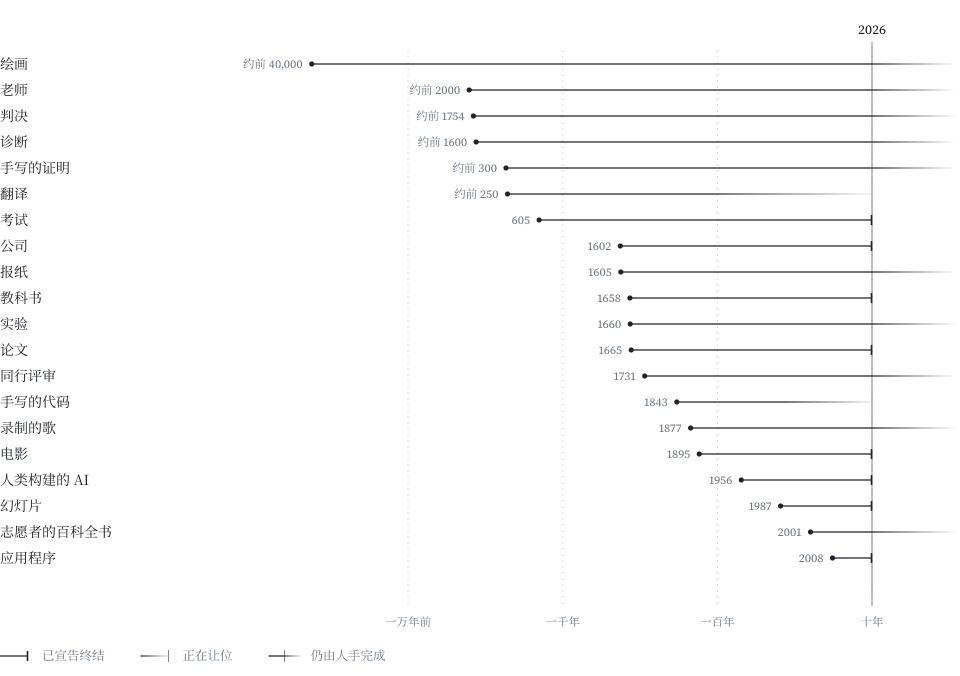

 

<picture>
  <source media="(prefers-color-scheme: dark)" srcset="docs/assets/mark-dark.svg">
  
</picture>

# 人类手作墓地

Awesome Last Human-Made · 一座安放人类手作之物的墓地

[English](README.md) · **简体中文**

 

每一篇论文、每一个证明、每一首歌、每一份判决背后，曾经都有一双手：有人为它熬过夜，涂改过，最后签下自己的名字。

如今，作品自己带着墓志铭来了：*The Last Human-Written Paper*、*The Last Math Competition*、*The Last AI Built by Humans*。而机器正安静地，把我们开了头的事，一件一件做完。

我们在这里把它们记下来：每一样东西生于何时，在人的手里留了多少年，又是谁说它已经结束。到目前为止，它们大多还在呼吸。

 

<picture>
  <source media="(prefers-color-scheme: dark)" srcset="docs/assets/timeline-zh-dark.svg">
  
</picture>

每条线从一种劳动诞生的那一年画到今天。二十条线，最长的约有四万年，在同一年相遇。

 

| 形式 | 生卒 | 现状
| :-- | :-- | :-- |
| [论文](#paper) | 1665 – 2026? | 已宣告终结 |
| [同行评审](#peer-review) | 1731 – | 仍由人手完成 |
| [手写的证明](#proof) | 约前 300 – | 仍由人手完成 |
| [考试](#exam) | 605 – 2026? | 已宣告终结 |
| [教科书](#textbook) | 1658 – 2026? | 已宣告终结 |
| [志愿者的百科全书](#encyclopedia) | 2001 – | 仍由人手完成 |
| [手写的代码](#code) | 1843 – 2026 | 正在让位 |
| [人类构建的 AI](#ai) | 1956 – 2026? | 已宣告终结 |
| [公司](#company) | 1602 – 2026? | 已宣告终结 |
| [应用程序](#app) | 2008 – 2026? | 已宣告终结 |
| [幻灯片](#slides) | 1987 – 2026? | 已宣告终结 |
| [电影](#film) | 1895 – 2026? | 已宣告终结 |
| [录制的歌](#song) | 1877 – | 仍由人手完成 |
| [报纸](#newspaper) | 1605 – | 仍由人手完成 |
| [翻译](#translation) | 约前 250 – 2026 | 正在让位 |
| [绘画](#art) | 约前 40,000 – | 仍由人手完成 |
| [老师](#teacher) | 约前 2000 – | 仍由人手完成 |
| [诊断](#diagnosis) | 约前 1600 – | 仍由人手完成 |
| [实验](#experiment) | 1660 – | 仍由人手完成 |
| [判决](#judgment) | 约前 1754 – | 仍由人手完成 |

 

 

<picture>
  <source media="(prefers-color-scheme: dark)" srcset="docs/assets/chapters/knowledge-zh-dark.svg">
  
</picture>

 

### 论文

**1665 – 2026?**

随《哲学汇刊》创刊而生。人类亲手完成它，已有 361 年。The Last Human-Written Paper 宣告了它的终结，继任者是面向智能体的研究制品。

> 它把三百年的科学装进八页纸，却删去了每一次失败的实验。

- **[The Last Human-Written Paper: Agent-Native Research Artifacts](https://arxiv.org/abs/2604.24658)** 
  用可执行的研究包取代叙事式 PDF，保留死胡同、设计决策和完整实现细节。 
  宣言、协议 · 2026 年 4 月 
  <a href="https://arxiv.org/abs/2604.24658"><picture><source media="(prefers-color-scheme: dark)" srcset="docs/assets/buttons/paper-arxiv-dark.svg"></picture></a> <a href="https://github.com/ARA-Labs/Agent-Native-Research-Artifact"><picture><source media="(prefers-color-scheme: dark)" srcset="docs/assets/buttons/code-code-dark.svg"></picture></a> <a href="https://github.com/Orchestra-Research/Agent-Native-Research-Artifact-template"><picture><source media="(prefers-color-scheme: dark)" srcset="docs/assets/buttons/code-template-dark.svg"></picture></a> <a href="https://github.com/ARA-Labs/ARA-Demo"><picture><source media="(prefers-color-scheme: dark)" srcset="docs/assets/buttons/code-demo-dark.svg"></picture></a>
- **[The AI Scientist-v2](https://www.nature.com/articles/s41586-026-10265-5)** 
  它完全由 AI 生成的论文通过了 ICLR 2025 研讨会的同行评审，系统本身发表在 Nature。 
  演示 · 2026 
  <a href="https://www.nature.com/articles/s41586-026-10265-5"><picture><source media="(prefers-color-scheme: dark)" srcset="docs/assets/buttons/paper-nature-dark.svg"></picture></a> <a href="https://x.com/SakanaAILabs/status/2036840833690071450"><picture><source media="(prefers-color-scheme: dark)" srcset="docs/assets/buttons/post-u9b7e3270-dark.svg"></picture></a>
- **[Agents4Science 2025](https://agents4science.stanford.edu)** 
  第一个由 AI 系统同时担任第一作者和审稿人的会议。 
  演示 · 2025 年 10 月 
  <a href="https://agents4science.stanford.edu"><picture><source media="(prefers-color-scheme: dark)" srcset="docs/assets/buttons/site-website-dark.svg"></picture></a> <a href="https://arxiv.org/abs/2511.15534"><picture><source media="(prefers-color-scheme: dark)" srcset="docs/assets/buttons/paper-report-dark.svg"></picture></a> <a href="https://x.com/james_y_zou/status/2001331557643276613"><picture><source media="(prefers-color-scheme: dark)" srcset="docs/assets/buttons/post-ued395fe4-dark.svg"></picture></a>
- **[paper.json](https://arxiv.org/abs/2605.16194)** 
  随 PDF 一起分发的伴随文件，为每条主张分配稳定 ID，并为智能体读者列出“不主张”清单。 
  协议 · 2026 年 5 月 
  <a href="https://arxiv.org/abs/2605.16194"><picture><source media="(prefers-color-scheme: dark)" srcset="docs/assets/buttons/paper-arxiv-dark.svg"></picture></a> <a href="https://github.com/arquicanedo/paper-json"><picture><source media="(prefers-color-scheme: dark)" srcset="docs/assets/buttons/code-code-dark.svg"></picture></a>
- **[Agentic Publication Protocol (APP)](https://arxiv.org/abs/2606.27386)** 
  把论文作为一次仓库发布，附带代码、数据、环境和面向智能体的说明文件。 
  协议 · 2026 年 6 月 
  <a href="https://arxiv.org/abs/2606.27386"><picture><source media="(prefers-color-scheme: dark)" srcset="docs/assets/buttons/paper-arxiv-dark.svg"></picture></a>
- **[Traxia: Verifiable, Agent-Native Scientific Publishing](https://arxiv.org/abs/2606.08256)** 
  协议 · 2026 年 6 月 
  <a href="https://arxiv.org/abs/2606.08256"><picture><source media="(prefers-color-scheme: dark)" srcset="docs/assets/buttons/paper-arxiv-dark.svg"></picture></a>
- **[Knows: Agent-Native Structured Research Representations](https://arxiv.org/abs/2604.17309)** 
  协议 · 2026 年 4 月 
  <a href="https://arxiv.org/abs/2604.17309"><picture><source media="(prefers-color-scheme: dark)" srcset="docs/assets/buttons/paper-arxiv-dark.svg"></picture></a>
- **[Rethinking Publication: A Certification Framework for AI-Enabled Research](https://arxiv.org/abs/2604.22026)** 
  把“评判知识”与“评定人类贡献”分开，让流水线生成的研究也能被一致地发表。 
  协议 · 2026 年 4 月 
  <a href="https://arxiv.org/abs/2604.22026"><picture><source media="(prefers-color-scheme: dark)" srcset="docs/assets/buttons/paper-arxiv-dark.svg"></picture></a>
- **[The Scientific Paper as a Human Artifact](https://www.preprints.org/manuscript/202609.2371)** 
  论文并未过时，但它的垄断正在结束；它面向人的功能需要被有意保留。 
  批评 · 2026 年 9 月 
  <a href="https://www.preprints.org/manuscript/202609.2371"><picture><source media="(prefers-color-scheme: dark)" srcset="docs/assets/buttons/paper-preprints-dark.svg"></picture></a>
- **[Should Researchers Write Papers for AI Instead of People?](https://spectrum.ieee.org/ai-scientist-research-paper-format)** 
  评论 · 2026 
  <a href="https://spectrum.ieee.org/ai-scientist-research-paper-format"><picture><source media="(prefers-color-scheme: dark)" srcset="docs/assets/buttons/article-ieee-spectrum-dark.svg"></picture></a>
- **[Again, the research paper format will be dying out](https://marginalrevolution.com/marginalrevolution/2026/06/again-the-paper-format-will-be-dying-out.html)** 
  评论 · 2026 年 6 月 
  <a href="https://marginalrevolution.com/marginalrevolution/2026/06/again-the-paper-format-will-be-dying-out.html"><picture><source media="(prefers-color-scheme: dark)" srcset="docs/assets/buttons/article-marginal-revolution-dark.svg"></picture></a>
- **[The Last Human-Written Paper](https://pub.towardsai.net/the-last-human-written-paper-a14d29470ff7)** 
  认为标题言过其实，这一方案主要适用于以代码为主的研究。 
  批评 · 2026 
  <a href="https://pub.towardsai.net/the-last-human-written-paper-a14d29470ff7"><picture><source media="(prefers-color-scheme: dark)" srcset="docs/assets/buttons/article-towards-ai-dark.svg"></picture></a>
 

<picture><source media="(prefers-color-scheme: dark)" srcset="docs/assets/mark-dark.svg"></picture>

 

### 同行评审

**1731 –**

随爱丁堡皇家学会经同行审阅的《医学论文集》而生。人类亲手完成它，已有 295 年，至今仍是。挑战来自会议规模的 AI 审稿。

> 还在读这篇论文，还在要求再补一个消融实验。

- **[AAAI-26 AI Review Pilot](https://arxiv.org/abs/2604.13940)** 
  为每篇投稿生成 AI 审稿意见，每篇成本不到 1 美元；受访者在技术准确性上更偏好 AI 审稿。 
  演示 · 2026 年 4 月 
  <a href="https://arxiv.org/abs/2604.13940"><picture><source media="(prefers-color-scheme: dark)" srcset="docs/assets/buttons/paper-arxiv-dark.svg"></picture></a>
- **[Position: Stop Automating Peer Review Without Rigorous Evaluation](https://proceedings.mlr.press/v306/baumann26a.html)** — ICML 2026 
  批评 
  <a href="https://proceedings.mlr.press/v306/baumann26a.html"><picture><source media="(prefers-color-scheme: dark)" srcset="docs/assets/buttons/paper-pmlr-dark.svg"></picture></a>
 

<picture><source media="(prefers-color-scheme: dark)" srcset="docs/assets/mark-dark.svg"></picture>

 

### 手写的证明

**约前 300 –**

生于欧几里得的《几何原本》。人类亲手完成它，已有 约 2,325 年，至今仍是。挑战来自写出机器可验证证明的智能体。

> 费马的页边太窄，机器的没有。

- **[Fermat’s Last Theorem in Lean 4](https://github.com/anthropics/fermats-last-theorem)** 
  完整的机器验证证明；Lean 源码由 AI 智能体在人类编写的开源 Lean 基础上生成。 
  演示 · 2026 
  <a href="https://github.com/anthropics/fermats-last-theorem"><picture><source media="(prefers-color-scheme: dark)" srcset="docs/assets/buttons/code-github-dark.svg"></picture></a> <a href="https://www.anthropic.com/research/formalizing-fermats-last-theorem"><picture><source media="(prefers-color-scheme: dark)" srcset="docs/assets/buttons/article-blog-dark.svg"></picture></a> <a href="https://x.com/AnthropicAI/status/2095947707605266436"><picture><source media="(prefers-color-scheme: dark)" srcset="docs/assets/buttons/post-u15cf6047-dark.svg"></picture></a>
- **[Advancing Mathematics Research with AI-Driven Formal Proof Search](https://arxiv.org/abs/2605.22763)** 
  一个智能体自主解决了 353 个公开 Erdős 问题中的 9 个。 
  演示 · 2026 年 5 月 
  <a href="https://arxiv.org/abs/2605.22763"><picture><source media="(prefers-color-scheme: dark)" srcset="docs/assets/buttons/paper-arxiv-dark.svg"></picture></a>
- **[Erdős Problem #728](https://arxiv.org/abs/2601.07421)** 
  第一个被公认由 AI 自主解决的 Erdős 问题。 
  演示 · 2026 年 1 月 
  <a href="https://arxiv.org/abs/2601.07421"><picture><source media="(prefers-color-scheme: dark)" srcset="docs/assets/buttons/paper-arxiv-dark.svg"></picture></a>
 

<picture><source media="(prefers-color-scheme: dark)" srcset="docs/assets/mark-dark.svg"></picture>

 

### 考试

**605 – 2026?**

随隋代科举而生。人类亲手完成它，已有 1,421 年。Humanity’s Last Exam、The Last Math Competition 宣告了它的终结，继任者是以未解难题为基准。

> 由人类出题，本该是机器最后过不去的一关。

- **[The Last Math Competition](https://github.com/The-Last-Math-Competition/The-Last-Math-Competition)** 
  “也许是人类举办的最后一场数学竞赛”。10,000 个猜想，每份解答都是附带 LaTeX 和无 sorry 的 Lean 4 项目的 PR；截至 2026-11 已解决 1,071 个。 
  宣言、演示 · 2026 
  <a href="https://github.com/The-Last-Math-Competition/The-Last-Math-Competition"><picture><source media="(prefers-color-scheme: dark)" srcset="docs/assets/buttons/code-github-dark.svg"></picture></a>
- **[Humanity’s Last Exam](https://arxiv.org/abs/2501.14249)** 
  这一命名方式的先驱：由专家出题，定位为 AI 的最后一场封闭式学术考试。 
  宣言 · 2025 年 1 月 
  <a href="https://arxiv.org/abs/2501.14249"><picture><source media="(prefers-color-scheme: dark)" srcset="docs/assets/buttons/paper-arxiv-dark.svg"></picture></a> <a href="https://lastexam.ai"><picture><source media="(prefers-color-scheme: dark)" srcset="docs/assets/buttons/article-website-dark.svg"></picture></a> <a href="https://x.com/danhendrycks/status/1882433928407241155"><picture><source media="(prefers-color-scheme: dark)" srcset="docs/assets/buttons/post-uaa7f8748-dark.svg"></picture></a>
 

<picture><source media="(prefers-color-scheme: dark)" srcset="docs/assets/mark-dark.svg"></picture>

 

### 教科书

**1658 – 2026?**

随夸美纽斯的《世界图解》而生。人类亲手完成它，已有 368 年。人类最后一本数理基础书 宣告了它的终结，继任者是围绕读者提问不断重写自己的教科书。

> 印一次，几年改一版，没有人读第二遍。

- **[Humanity’s Last Math Book · 人类最后一本数理基础书](https://github.com/niuniu-869/humanitys-last-math-book)** 
  从中学数学一直讲到理解大模型的开源教材，根据读者提问持续修订。 
  宣言、演示 · 2026 
  <a href="https://github.com/niuniu-869/humanitys-last-math-book"><picture><source media="(prefers-color-scheme: dark)" srcset="docs/assets/buttons/code-github-dark.svg"></picture></a>
 

<picture><source media="(prefers-color-scheme: dark)" srcset="docs/assets/mark-dark.svg"></picture>

 

### 志愿者的百科全书

**2001 –**

随维基百科的第一次编辑而生。人类亲手完成它，已有 25 年，至今仍是。挑战来自完全由 AI 写成的百科全书。

> 由陌生人写给陌生人，分文不取。

- **[Grokipedia](https://grokipedia.com)** 
  上线时约有 88.5 万篇 AI 撰写的条目；独立分析发现其中大量内容源自维基百科。 
  演示、批评 · 2025 年 10 月 
  <a href="https://grokipedia.com"><picture><source media="(prefers-color-scheme: dark)" srcset="docs/assets/buttons/site-website-dark.svg"></picture></a> <a href="https://arxiv.org/abs/2511.09685"><picture><source media="(prefers-color-scheme: dark)" srcset="docs/assets/buttons/paper-analysis-dark.svg"></picture></a>

 

 

<picture>
  <source media="(prefers-color-scheme: dark)" srcset="docs/assets/chapters/building-zh-dark.svg">
  
</picture>

 

### 手写的代码

**1843 – 2026**

生于阿达·洛芙莱斯的“注释 G”。人类亲手完成它，已有 183 年；如今正让位于智能体，外加一个仍要签字的人。宣告者：Last Human Commit、The Last Harness。

> 七十年来，一个字符一个字符地敲出来。

- **[Last Human Commit](https://github.com/megamen32/LastHumanCommit)** 
  自动化工程流程：从一句粗糙的需求（甚至语音转写）一路做到测试通过并合并的改动。 
  演示 · 2026 
  <a href="https://github.com/megamen32/LastHumanCommit"><picture><source media="(prefers-color-scheme: dark)" srcset="docs/assets/buttons/code-github-dark.svg"></picture></a>
- **[The Last Harness](https://github.com/diegopetrucci/the-last-harness)** 
  “你需要的最后一个 harness”，核心信条是：思考可以外包，理解不能。 
  宣言 · 2026 
  <a href="https://github.com/diegopetrucci/the-last-harness"><picture><source media="(prefers-color-scheme: dark)" srcset="docs/assets/buttons/code-github-dark.svg"></picture></a>
- **[The Last Human](https://github.com/microsoft-2026-hackathon/the-last-human)** 
  一道人工关卡：高风险的智能体 PR 合并前，作者必须对照代码讲清楚这次改动。 
  守护 · 2026 
  <a href="https://github.com/microsoft-2026-hackathon/the-last-human"><picture><source media="(prefers-color-scheme: dark)" srcset="docs/assets/buttons/code-github-dark.svg"></picture></a>
 

<picture><source media="(prefers-color-scheme: dark)" srcset="docs/assets/mark-dark.svg"></picture>

 

### 人类构建的 AI

**1956 – 2026?**

生于达特茅斯会议。人类亲手完成它，已有 70 年。The Last AI Built by Humans 宣告了它的终结，继任者是递归式自我改进。

> 由它将要取代的人训练、调优、发布。

- **[The Last AI Built by Humans: Toward Genuine Recursive Self-Improvement](https://arxiv.org/abs/2609.11873)** 
  宣言 · 2026 年 9 月 
  <a href="https://arxiv.org/abs/2609.11873"><picture><source media="(prefers-color-scheme: dark)" srcset="docs/assets/buttons/paper-arxiv-dark.svg"></picture></a> <a href="https://x.com/askalphaxiv/status/2099090716186038640"><picture><source media="(prefers-color-scheme: dark)" srcset="docs/assets/buttons/post-uff26629c-dark.svg"></picture></a>
- **[When AI Builds Itself](https://www.anthropic.com/institute/recursive-self-improvement)** — Anthropic Institute 
  Anthropic 合并的代码中，超过 80% 由 Claude 编写。 
  演示 · 2026 年 6 月 
  <a href="https://www.anthropic.com/institute/recursive-self-improvement"><picture><source media="(prefers-color-scheme: dark)" srcset="docs/assets/buttons/article-anthropic-dark.svg"></picture></a> <a href="https://x.com/AnthropicAI/status/2062568862479208923"><picture><source media="(prefers-color-scheme: dark)" srcset="docs/assets/buttons/post-u15cf6047-dark.svg"></picture></a>
 

<picture><source media="(prefers-color-scheme: dark)" srcset="docs/assets/mark-dark.svg"></picture>

 

### 公司

**1602 – 2026?**

随荷兰东印度公司而生。人类亲手完成它，已有 424 年。MiniCorp: The Last Mile 宣告了它的终结，继任者是由智能体组成的公司。

> 它曾经需要每张桌子后面都坐着一个人。

- **[MiniCorp: The Last Mile to an AI Agent Corporation](https://arxiv.org/abs/2610.05912)** 
  宣言、演示 · 2026 年 10 月 
  <a href="https://arxiv.org/abs/2610.05912"><picture><source media="(prefers-color-scheme: dark)" srcset="docs/assets/buttons/paper-arxiv-dark.svg"></picture></a>
- **[Project Vend](https://www.anthropic.com/news/project-vend-2)** — Anthropic × Andon Labs 
  Claude 经营一家办公室小店，负责进货、定价和顾客；第二阶段开始盈利。 
  演示 · 2025 
  <a href="https://www.anthropic.com/news/project-vend-2"><picture><source media="(prefers-color-scheme: dark)" srcset="docs/assets/buttons/article-anthropic-dark.svg"></picture></a> <a href="https://x.com/AnthropicAI/status/2001686747185394148"><picture><source media="(prefers-color-scheme: dark)" srcset="docs/assets/buttons/post-u15cf6047-dark.svg"></picture></a>
 

<picture><source media="(prefers-color-scheme: dark)" srcset="docs/assets/mark-dark.svg"></picture>

 

### 应用程序

**2008 – 2026?**

随 App Store 而生。人类亲手完成它，已有 18 年。The End of Apps 宣告了它的终结，继任者是按人、按时生成的界面。

> 只设计一次，给所有人，对每个人都一样。

- **[The End of Apps](https://ai.engineer/talks/the-end-of-apps)** — AI Engineer Europe 2026 
  宣言 
  <a href="https://ai.engineer/talks/the-end-of-apps"><picture><source media="(prefers-color-scheme: dark)" srcset="docs/assets/buttons/talk-talk-dark.svg"></picture></a>
 

<picture><source media="(prefers-color-scheme: dark)" srcset="docs/assets/mark-dark.svg"></picture>

 

### 幻灯片

**1987 – 2026?**

随 PowerPoint 而生。人类亲手完成它，已有 39 年。The Last Boring Slide、The Last Default Slide 宣告了它的终结，继任者是生成式、可交互的网页演示。

> 请翻下一页。

- **[The Last Boring Slide](https://claude.ai/artifact/Cy2d8Vn63CnzCtonA1LSah)** 
  一场关于智能爆炸的演讲：开场是一张平淡的默认幻灯片，随后开始自我改写。由 Nikita（@fluxxrider）发布，他称这是 Claude 根据一句提示词做出的；帖子一天内浏览量超过六百万。 
  宣言、演示 · 2026 年 11 月 
  <a href="https://claude.ai/artifact/Cy2d8Vn63CnzCtonA1LSah"><picture><source media="(prefers-color-scheme: dark)" srcset="docs/assets/buttons/site-live-demo-dark.svg"></picture></a> <a href="https://x.com/fluxxrider/status/2125622238481371372"><picture><source media="(prefers-color-scheme: dark)" srcset="docs/assets/buttons/post-u399a515b-dark.svg"></picture></a>
- **[The Last Default Slide](https://fibonacciai.github.io/last-default-slide/)** 
  一份实时、可交互的演示，回顾最近四周的 AI、数学与科学进展。 
  演示 · 2026 
  <a href="https://fibonacciai.github.io/last-default-slide/"><picture><source media="(prefers-color-scheme: dark)" srcset="docs/assets/buttons/site-live-demo-dark.svg"></picture></a> <a href="https://github.com/FibonacciAi/last-default-slide"><picture><source media="(prefers-color-scheme: dark)" srcset="docs/assets/buttons/code-code-dark.svg"></picture></a>

 

 

<picture>
  <source media="(prefers-color-scheme: dark)" srcset="docs/assets/chapters/culture-zh-dark.svg">
  
</picture>

 

### 电影

**1895 – 2026?**

生于卢米埃尔兄弟的第一次公开放映。人类亲手完成它，已有 131 年。The Last Screenwriter 宣告了它的终结，继任者是逐镜头生成的长片。

> 灯光、摄影、开拍，如今三样都可有可无。

- **[The Last Screenwriter](https://en.wikipedia.org/wiki/The_Last_Screenwriter)** 
  一部剧本由 ChatGPT-4 写成的瑞士长片，讲述一位编剧遭遇会写剧本的 AI。 
  宣言、演示 · 2024 年 6 月 
  <a href="https://en.wikipedia.org/wiki/The_Last_Screenwriter"><picture><source media="(prefers-color-scheme: dark)" srcset="docs/assets/buttons/article-wikipedia-dark.svg"></picture></a>
- **[Gods Don’t Give Gifts](https://futurism.com/artificial-intelligence/first-fully-ai-movie-mpa-academy-award)** 
  完全由 AI 生成的长片，获 MPA R 级评级，2026 年 12 月在美国院线上映。 
  演示 · 2026 年 12 月 
  <a href="https://futurism.com/artificial-intelligence/first-fully-ai-movie-mpa-academy-award"><picture><source media="(prefers-color-scheme: dark)" srcset="docs/assets/buttons/article-futurism-dark.svg"></picture></a>
- **[Sanxingdui — Future Past · 三星堆：未来启示录](https://technode.com/2026/09/28/chinas-first-ai-produced-theatrical-film-sets-october-23-release/)** 
  博纳影业出品的 AI 制作长片，在中国院线上映。 
  演示 · 2026 年 10 月 
  <a href="https://technode.com/2026/09/28/chinas-first-ai-produced-theatrical-film-sets-october-23-release/"><picture><source media="(prefers-color-scheme: dark)" srcset="docs/assets/buttons/article-technode-dark.svg"></picture></a>
- **[Dreams of Violets](https://www.thewrap.com/creative-content/movies/ai-movie-trailer-dreams-of-violets-iran-tribeca/)** 
  在 2026 年翠贝卡电影节放映的全 AI 生成真人风格长片。 
  演示 · 2026 年 6 月 
  <a href="https://www.thewrap.com/creative-content/movies/ai-movie-trailer-dreams-of-violets-iran-tribeca/"><picture><source media="(prefers-color-scheme: dark)" srcset="docs/assets/buttons/article-thewrap-dark.svg"></picture></a>
 

<picture><source media="(prefers-color-scheme: dark)" srcset="docs/assets/mark-dark.svg"></picture>

 

### 录制的歌

**1877 –**

生于爱迪生的留声机。人类亲手完成它，已有 149 年，至今仍是。挑战来自登上 Billboard 榜单的 AI 歌手。

> 唱它的人，得在两句之间换气。

- **[Breaking Rust · Xania Monet](https://www.billboard.com/pro/ai-music-artists-charts-popular/)** 
  一位 AI 歌手登上 Billboard 乡村数字单曲销量榜首，另一位进入 Billboard 电台榜。 
  演示 · 2025 年 11 月 
  <a href="https://www.billboard.com/pro/ai-music-artists-charts-popular/"><picture><source media="(prefers-color-scheme: dark)" srcset="docs/assets/buttons/article-billboard-dark.svg"></picture></a>
 

<picture><source media="(prefers-color-scheme: dark)" srcset="docs/assets/mark-dark.svg"></picture>

 

### 报纸

**1605 –**

随斯特拉斯堡的《通告》而生。人类亲手完成它，已有 421 年，至今仍是。挑战来自完全由 AI 写成的印刷版。

> 午夜前交稿，写稿的人当时就在现场。

- **[Il Foglio AI](https://www.ilfoglio.it/il-foglio-ai/2025/03/22/news/a-first-assessment-of-foglio-ai-written-by-foglio-ai-with-a-scolding--7547053/)** 
  一家意大利日报连续一个月随报附送四版完全由 AI 写成的增刊，文章、标题、引语、摘要乃至读者来信都由 AI 完成，记者只负责写提示词。 
  演示 · 2025 年 3 月 
  <a href="https://www.ilfoglio.it/il-foglio-ai/2025/03/22/news/a-first-assessment-of-foglio-ai-written-by-foglio-ai-with-a-scolding--7547053/"><picture><source media="(prefers-color-scheme: dark)" srcset="docs/assets/buttons/article-il-foglio-dark.svg"></picture></a>
 

<picture><source media="(prefers-color-scheme: dark)" srcset="docs/assets/mark-dark.svg"></picture>

 

### 翻译

**约前 250 – 2026**

随《七十士译本》而生。人类亲手完成它，已有 约 2,275 年；如今正让位于公司规模的机器翻译与合成语音。宣告者：Duolingo 的 “AI-first” 内部信。

> 两种语言之间，曾经站着一个人。

- **[Duolingo goes “AI-first”](https://www.theregister.com/2025/04/29/duolingo_ceo_ai_first_shift)** 
  CEO 内部信：逐步停止让外包承担 AI 能做的工作，并接受“质量上的小损失”。 
  宣言 · 2025 年 4 月 
  <a href="https://www.theregister.com/2025/04/29/duolingo_ceo_ai_first_shift"><picture><source media="(prefers-color-scheme: dark)" srcset="docs/assets/buttons/article-the-register-dark.svg"></picture></a>
 

<picture><source media="(prefers-color-scheme: dark)" srcset="docs/assets/mark-dark.svg"></picture>

 

### 绘画

**约前 40,000 –**

生于洞穴的岩壁。人类亲手完成它，已有 约 42,025 年，至今仍是。挑战来自进入大型拍卖行的 AI 艺术。

> 角落里有一个签名。

- **[Augmented Intelligence](https://www.theartnewspaper.com/2025/03/05/christies-augmented-intelligence-sale)** — Christie’s 
  大型拍卖行的第一场 AI 艺术专场，总成交额 728,784 美元。 
  演示 · 2025 年 3 月 
  <a href="https://www.theartnewspaper.com/2025/03/05/christies-augmented-intelligence-sale"><picture><source media="(prefers-color-scheme: dark)" srcset="docs/assets/buttons/article-the-art-newspaper-dark.svg"></picture></a>

 

 

<picture>
  <source media="(prefers-color-scheme: dark)" srcset="docs/assets/chapters/care-zh-dark.svg">
  
</picture>

 

### 老师

**约前 2000 –**

生于苏美尔的泥板书舍。人类亲手完成它，已有 约 4,025 年，至今仍是。挑战来自AI 导师加人类“向导”。

> 记得教室里每一个人的名字。

- **[Alpha School](https://axios.com/2026/08/02/alpha-schools-ai-expansion-50-campuses)** 
  每天两小时由 AI 辅导的学科学习，成年人担任向导而非教师；正扩张到约 50 个校区。 
  演示 · 2026 年 8 月 
  <a href="https://axios.com/2026/08/02/alpha-schools-ai-expansion-50-campuses"><picture><source media="(prefers-color-scheme: dark)" srcset="docs/assets/buttons/article-axios-dark.svg"></picture></a>
- **[Alpha School’s own data](https://fortune.com/2026/11/14/alpha-school-ai-students-tuition-learning-goals)** — Fortune, on NYT reporting 
  《纽约时报》披露的内部数据：只有 42% 的学生达到学校设定的 2 倍学习目标。 
  批评 · 2026 年 11 月 
  <a href="https://fortune.com/2026/11/14/alpha-school-ai-students-tuition-learning-goals"><picture><source media="(prefers-color-scheme: dark)" srcset="docs/assets/buttons/article-fortune-dark.svg"></picture></a>
 

<picture><source media="(prefers-color-scheme: dark)" srcset="docs/assets/mark-dark.svg"></picture>

 

### 诊断

**约前 1600 –**

生于埃德温·史密斯纸草文稿。人类亲手完成它，已有 约 3,625 年，至今仍是。挑战来自在研究中诊断胜过医生的模型。

> 先倾听，再检查。

- **[Reasoning model vs. physicians on real ED cases](https://www.npr.org/2026/04/30/nx-s1-5804474/ai-doctors-openai-patient-care-diagnosis)** — Science, via NPR 
  哈佛与贝斯以色列医院的研究发现，OpenAI 的推理模型在真实急诊病例上表现优于医生。 
  演示 · 2026 年 4 月 
  <a href="https://www.npr.org/2026/04/30/nx-s1-5804474/ai-doctors-openai-patient-care-diagnosis"><picture><source media="(prefers-color-scheme: dark)" srcset="docs/assets/buttons/article-npr-dark.svg"></picture></a>
- **[MAI-DxO](https://singularityhub.com/2026/11/04/microsofts-medical-ai-is-over-twice-as-good-diagnosing-diseases-as-doctors/)** — Microsoft 
  在复杂诊断病例上，准确率是全科医生的两倍以上。 
  演示 · 2026 
  <a href="https://singularityhub.com/2026/11/04/microsofts-medical-ai-is-over-twice-as-good-diagnosing-diseases-as-doctors/"><picture><source media="(prefers-color-scheme: dark)" srcset="docs/assets/buttons/article-singularity-hub-dark.svg"></picture></a>
- **[DeepRare](https://thenextweb.com/news/how-an-ai-system-beat-experienced-doctors-at-diagnosing-rare-diseases)** — Nature 
  一个在罕见病诊断上胜过资深专科医生的智能体系统。 
  演示 · 2026 
  <a href="https://thenextweb.com/news/how-an-ai-system-beat-experienced-doctors-at-diagnosing-rare-diseases"><picture><source media="(prefers-color-scheme: dark)" srcset="docs/assets/buttons/article-tnw-dark.svg"></picture></a>
 

<picture><source media="(prefers-color-scheme: dark)" srcset="docs/assets/mark-dark.svg"></picture>

 

### 实验

**1660 –**

随波义耳的空气泵而生。人类亲手完成它，已有 366 年，至今仍是。挑战来自从不休息的自动驾驶实验室。

> 移液到深夜，天亮才回家。

- **[Self-driving labs — A-Lab, Eve, Argonne, PNNL](https://www.scientificamerican.com/article/autonomous-labs-are-running-science-experiments-24-7/)** 
  闭环机器人实验室昼夜不停地做实验，但结果仍要由人来核查和解释。 
  演示、评论 · 2026 
  <a href="https://www.scientificamerican.com/article/autonomous-labs-are-running-science-experiments-24-7/"><picture><source media="(prefers-color-scheme: dark)" srcset="docs/assets/buttons/article-scientific-american-dark.svg"></picture></a>
- **[Rentosertib](https://pubmed.ncbi.nlm.nih.gov/40461817/)** — Nature Medicine 
  靶点和分子都由 AI 发现，在特发性肺纤维化的 2a 期试验中取得积极结果。 
  演示 · 2025 年 6 月 
  <a href="https://pubmed.ncbi.nlm.nih.gov/40461817/"><picture><source media="(prefers-color-scheme: dark)" srcset="docs/assets/buttons/paper-pubmed-dark.svg"></picture></a>
 

<picture><source media="(prefers-color-scheme: dark)" srcset="docs/assets/mark-dark.svg"></picture>

 

### 判决

**约前 1754 –**

随《汉谟拉比法典》而生。人类亲手完成它，已有 约 3,779 年，至今仍是。挑战来自试点 AI 起草判决的法院。

> 由一位要为它负责的法官签名。

- **[Keep Humans on the Bench](https://dailyjournal.com/articles/393976-keep-humans-on-the-bench)** 
  评论洛杉矶县 “Learned Hand” 判决草稿试点，以及台湾、法兰克福的类似做法。 
  批评 · 2026 
  <a href="https://dailyjournal.com/articles/393976-keep-humans-on-the-bench"><picture><source media="(prefers-color-scheme: dark)" srcset="docs/assets/buttons/article-daily-journal-dark.svg"></picture></a>

 

 

## 挽歌

那些为自己曾经亲手做的事写下悼文的人。

- **[Farewell, programming](https://staltz.com/farewell-programming)** — André Staltz 
  2026 年很可能是他亲手写代码的最后一年。 
  2026 
  <a href="https://staltz.com/farewell-programming"><picture><source media="(prefers-color-scheme: dark)" srcset="docs/assets/buttons/article-blog-dark.svg"></picture></a> <a href="#code"><picture><source media="(prefers-color-scheme: dark)" srcset="docs/assets/buttons/mourn-ufc5913b7-dark.svg"></picture></a>
- **[We mourn our craft](https://nolanlawson.com/2026/02/07/we-mourn-our-craft/)** — Nolan Lawson 
  2026 年 2 月 
  <a href="https://nolanlawson.com/2026/02/07/we-mourn-our-craft/"><picture><source media="(prefers-color-scheme: dark)" srcset="docs/assets/buttons/article-blog-dark.svg"></picture></a> <a href="#code"><picture><source media="(prefers-color-scheme: dark)" srcset="docs/assets/buttons/mourn-ufc5913b7-dark.svg"></picture></a>
- **[The Last Human Milestone](https://cbcrenshaw.com/2026/05/07/the-last-human-milestone/)** 
  人类写下所有上线改动的最后时刻。 
  2026 年 5 月 
  <a href="https://cbcrenshaw.com/2026/05/07/the-last-human-milestone/"><picture><source media="(prefers-color-scheme: dark)" srcset="docs/assets/buttons/article-blog-dark.svg"></picture></a> <a href="#code"><picture><source media="(prefers-color-scheme: dark)" srcset="docs/assets/buttons/mourn-ufc5913b7-dark.svg"></picture></a>
- **[The Last Human-Written Code: A Prediction Timeline](https://medium.com/@coders.stop/the-last-human-written-code-a-prediction-timeline-5f15c3c6773e)** 
  2026 
  <a href="https://medium.com/@coders.stop/the-last-human-written-code-a-prediction-timeline-5f15c3c6773e"><picture><source media="(prefers-color-scheme: dark)" srcset="docs/assets/buttons/article-medium-dark.svg"></picture></a> <a href="#code"><picture><source media="(prefers-color-scheme: dark)" srcset="docs/assets/buttons/mourn-ufc5913b7-dark.svg"></picture></a>
- **[The final human year — 2026](https://nofilk.substack.com/p/the-final-human-year-2026)** 
  2026 
  <a href="https://nofilk.substack.com/p/the-final-human-year-2026"><picture><source media="(prefers-color-scheme: dark)" srcset="docs/assets/buttons/article-substack-dark.svg"></picture></a> <a href="#ai"><picture><source media="(prefers-color-scheme: dark)" srcset="docs/assets/buttons/mourn-u77640dd9-dark.svg"></picture></a>

 

## 先祖

这种句式比看上去更古老。

- **[The Last One](https://hackernoon.com/programming-has-been-dying-since-1954-ai-might-finally-change-it)** 
  一款程序生成器，号称是你需要购买的最后一个程序。程序员最终并没有被取代。 
  1981 
  <a href="https://hackernoon.com/programming-has-been-dying-since-1954-ai-might-finally-change-it"><picture><source media="(prefers-color-scheme: dark)" srcset="docs/assets/buttons/article-hackernoon-dark.svg"></picture></a>

## 中文语境

- **[AI原生格式，正在杀死PDF论文](https://www.tmtpost.com/agent/ai-article?id=19677)** 
  介绍 The Last Human-Written Paper 与 ARA 协议：论文用传统格式预言了传统的终结。 
  2026 
  <a href="https://www.tmtpost.com/agent/ai-article?id=19677"><picture><source media="(prefers-color-scheme: dark)" srcset="docs/assets/buttons/article-u1a511d0a-dark.svg"></picture></a>
- **[未来的文章是写给谁看的？AI时代的知识生产困局](https://www.huxiu.com/article/4873372.html)** — 虎嗅 / 生态学时空 
  信息层的综述写作已失去交换价值，只有 AI 无法生成的判断与问题还值得写。 
  2026 
  <a href="https://www.huxiu.com/article/4873372.html"><picture><source media="(prefers-color-scheme: dark)" srcset="docs/assets/buttons/article-u451ad721-dark.svg"></picture></a>

## 收录范围

收录以下作品：因为 AI 已经能做，而宣告某种人类产出形式终结的（宣言）；提出面向智能体的替代形式的（协议）；展示 AI 完整做出这种形式、并有公开记录的（演示）；以及回应以上任何一类的（守护、批评、评论）。

不收录：只是名字里带 “last” 的作品、没有宣称取代某种形式的 AI 工具，以及无法追溯到一手或可靠来源的说法。有争议的案例，等尘埃落定再说。

诞生年份取的是约定俗成的起点，而非发明时间。状态是编者的判断，会随证据向任一方向变化。

## 参与贡献

本页全部内容由 [`data/graveyard.yml`](data/graveyard.yml) 生成。在其中添加条目，运行 `pip install -r scripts/requirements.txt && python scripts/build.py`（需要 Python 3.9+ 和 Node.js，字体只在第一次运行时下载），然后提交 PR。不确定放在哪里？提一个 issue，写下标题、链接和一句话就够了。

## 许可

清单内容以 [CC0 1.0](LICENSE) 贡献至公有领域；构建脚本采用 [MIT 许可证](scripts/LICENSE)。所链接的作品归其作者所有。

 

这里的每一样东西，都曾被某个人以为会长久存在。

